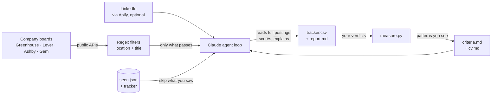

# Job Scout Agent

An AI agent that scans job boards for you, reads every posting against your criteria and your CV, and hands you a short list with a fit score, an interest score and the main tradeoff of each job. **It brings options; you decide.**

I built it for my own job search in October 2026 with the [Claude Agent SDK](https://docs.claude.com/en/docs/agent-sdk/overview), measured it against my own verdicts on real postings, and then made it generic so anyone can clone it, answer a few questions and run it.

A typical run reviews 30 to 40 postings and costs about **US$0.20**.

## Why

Job boards are noisy. The roles worth your time are spread across company career pages and LinkedIn, and titles are unreliable: a "Senior Manager" can have more scope than a "Head of". Reading everything yourself takes hours a week. Keyword alerts miss the good jobs with odd titles and flood you with the wrong ones.

The agent reads the full posting, judges it the way you would, and tells you why. The design rule that shaped everything: **hiding a job you would want is the expensive mistake; showing you one you dismiss in ten seconds is cheap.** So it filters with "when in doubt, show", and leaves the decision to you.

## Quick start

```bash
git clone https://github.com/jonaslnino/job-scout-agent.git
cd job-scout-agent
python -m venv .venv && source .venv/bin/activate   # Windows: .venv\Scripts\activate
pip install -r requirements.txt

python onboard.py    # ~10 minutes: keys, your criteria, companies to watch
python sources.py    # free check: how many jobs each board has and how many pass your filters
python agent.py      # first run
```

Results land in `output/tracker.csv` (opens in Excel or Google Sheets) and a readable report per run, `output/report-*.md`.

### What onboarding asks

1. **Keys.** Anthropic is required: it is the model that reads and scores every job. Apify is optional: it adds LinkedIn search for about US$0.02 per run. Without it, the agent scans only the company job boards you list, which are free.
2. **Your search.** Target roles, minimum level, where you can work, minimum compensation, languages, hard blockers, soft "no" signals, and "magnets" (things that make you want to see a job anyway). Optionally, your CV as plain text.
3. **Companies to watch.** Paste careers links; it detects Greenhouse, Lever, Ashby and Gem boards automatically.

It writes everything to `profile/` and `.env`, both git-ignored. Your criteria become `profile/criteria.md`: a plain document you can read and edit, and the agent's entire brief.

## How it works



An agent is a loop: the model thinks, asks for a tool, observes the result, and repeats until it is done. The SDK runs that loop. This repo provides the instructions, the tools and the guardrails.

**Tools the agent can use**

| Tool | What it does |
|---|---|
| `scan_board` | Reads one company's board through its public API, already filtered |
| `search_linkedin` | LinkedIn search through Apify, with a per-run budget |
| `read_job` | Full text of a posting it already found, at no network cost |
| `WebSearch` / `WebFetch` | Discovery outside your list of boards, capped by a hook |
| `save_results` | Validates the output and writes the tracker and the report |

**Design decisions**

- **Deterministic code does the cheap work; the model does the judgment.** A board like Stripe lists 700+ jobs. Filtering them by location and title with a regex is free and always gives the same answer, so only the survivors reach the model.
- **Limits live in code, not in the prompt.** Spend caps, per-source budgets and a pre-tool hook stop the run, whatever the model "wants". The agent can only use the tools registered for that run, and it refuses to run on anything but your API key.
- **It brings options; you decide.** Every shown job gets two scores (fit: can you do it very well; interest: does it give you what you want), a recommendation, its gaps marked bridgeable or hard, and the main tradeoff. The recommendation is information, not a filter.
- **Honesty rule.** Every reason cites the posting or the CV. If the posting doesn't say, the answer is "unknown", never a guess.
- **No memory between runs, on purpose.** What it "learns" lives in `criteria.md`, a document you can read, edit and version. `seen.json` keeps it from showing you the same job twice.

## Measuring it

A job agent is only useful if it catches the jobs you'd want. Mark `my_verdict` (yes / maybe / no) in the tracker and run `python measure.py`. It reports, per criteria version:

- **Catch rate:** of the jobs you wanted, how many it recommended High or Medium.
- **Noise:** of the jobs you passed on, how many it recommended High.

This is how I tuned it. Each version of my criteria was measured on postings I had already judged, and the rule was to test a new version on postings **not** used to write it; otherwise it just memorizes:

| Version | What changed | Caught the jobs I wanted | Shown but I passed |
|---|---|---|---|
| v3 | Scoring on two axes (fit, interest) | 2 of 4 | 1 of 8 |
| v4 | Verdict as an action | 2 of 4 | 2 of 8 |
| v5 | "Bring options, don't decide": filter with "when in doubt, show" | 3 of 4 | 3 of 6 |

v3 and v4 were measured on 12 postings I had judged; v5 on the 10 I judged from a fresh sample of 20, drawn from the same sources as a normal run. The one miss required a language I don't speak, which my own rules said to hide: the agent was right by the rules, so the rule was the thing to revisit.

## Cost and limits

- About US$0.18 of Anthropic and US$0.02 of Apify per run. `max_spend_usd` in `profile/settings.json` caps the model spend per run (default US$1.50).
- LinkedIn search looks at the last week and is capped at 20 postings per run (`linkedin_cap`).
- Uber runs its own careers site; it is supported as a source with `{"system": "uber", "slug": "<Country>"}` in `profile/sources.json`.
- The agent never applies, never contacts anyone and never logs in to LinkedIn with your account.

## Files

| File | What it is |
|---|---|
| `onboard.py` | Setup: keys, questions, profile |
| `agent.py` | The agent: tools, guardrails, prompt, loop |
| `sources.py` | Job board readers and regex filters (`python sources.py` for a free check) |
| `seen.py` | Memory of jobs already seen |
| `output.py` | Tracker CSV and Markdown report |
| `measure.py` | Catch rate and noise from your verdicts |
| `examples/` | A sample answers file for non-interactive setup |

## License

MIT. Built by [Jonas López Niño](https://linkedin.com/in/jonasnino).
