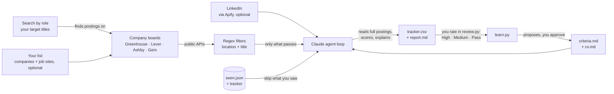

# Job Scout Agent

An AI agent that searches for the roles you want across many companies, reads every posting against your criteria and your CV, and hands you a short list with a fit score, an interest score and the main tradeoff of each job. **It brings options; you decide.**

I built it for my own job search in October 2026 with the [Claude Agent SDK](https://docs.claude.com/en/docs/agent-sdk/overview), measured it against my own verdicts on real postings, and then made it generic so anyone can clone it, answer a few questions and run it.

A typical run reviews 30 to 40 postings and costs well under **US$1** (about US$0.20 before role search was added; the web searches add roughly US$0.02 each). A hard cap stops any run at US$1.50.

## Why

Job boards are noisy. The roles worth your time are spread across hundreds of company career pages and LinkedIn, often at companies you have never heard of, and titles are unreliable: a "Senior Manager" can have more scope than a "Head of". Reading everything yourself takes hours a week. Keyword alerts miss the good jobs with odd titles and flood you with the wrong ones.

The agent reads the full posting, judges it the way you would, and tells you why. The design rule that shaped everything: **hiding a job you would want is the expensive mistake; showing you one you dismiss in ten seconds is cheap.** So it filters with "when in doubt, show", and leaves the decision to you.

## Easiest: let Claude set it up

No terminal and no coding. You need [Claude Code](https://docs.claude.com/en/docs/claude-code/overview) and an Anthropic API key.

1. **Get the code.** On this page, click the green **Code** button → **Download ZIP**, and unzip it wherever you like. (If you use git: `git clone https://github.com/jonaslnino/job-scout-agent.git`.) You don't need to create a new project: this folder is the project.
2. **Open the folder in Claude Code.** In the Claude desktop app, open Claude Code and choose the folder you just unzipped (from the ZIP it is called `job-scout-agent-main`). From a terminal, go into the folder and type `claude`.
3. **Say: "Set this up for me."** Claude follows [CLAUDE.md](CLAUDE.md) one step at a time: it installs what's needed, then helps you get an API key if you don't have one.
4. **Paste your API key when Claude asks.** It creates a `.env` file for you to paste the key into, so the key never goes through the chat.
5. **Talk about your search.** One question at a time: the roles you want, level, where you can work, pay, what you never want to see. When an answer is vague, Claude asks until it's precise. If you have postings you'd love, share them: they calibrate the agent.
6. **Run and rate.** Claude turns your CV into plain text and asks for your OK before the first paid run (under US$1, with a hard cap). Then it opens a page where you rate each job with one click.

## Quick start (terminal)

macOS / Linux:

```bash
git clone https://github.com/jonaslnino/job-scout-agent.git
cd job-scout-agent
python3 -m venv .venv
.venv/bin/python -m pip install -r requirements.txt

.venv/bin/python onboard.py    # ~10 minutes: keys, your criteria, companies to watch
.venv/bin/python sources.py    # free check: how many jobs each board has and how many pass your filters
.venv/bin/python agent.py      # first run
.venv/bin/python review.py     # rate the jobs in your browser
```

Windows (PowerShell): use the `py` launcher, since `python` is often a Microsoft Store shortcut, and call the environment's Python with `.\`:

```powershell
git clone https://github.com/jonaslnino/job-scout-agent.git
cd job-scout-agent
py -m venv .venv
.\.venv\Scripts\python.exe -m pip install -r requirements.txt

.\.venv\Scripts\python.exe onboard.py
.\.venv\Scripts\python.exe sources.py
.\.venv\Scripts\python.exe agent.py
.\.venv\Scripts\python.exe review.py
```

Results land in `output/tracker.csv` (opens in Excel or Google Sheets) and a readable report per run, `output/report-*.md`.

### What onboarding asks

1. **Keys.** Anthropic is required: it is the model that reads and scores every job. Apify is optional: it adds LinkedIn search for about US$0.02 per run. Without it, the agent searches the web by role and reads public job boards; you pay only the model's tokens.
2. **Your search.** Target roles (the heart of the search), minimum level, where you can work, minimum compensation, languages, hard blockers, soft "no" signals, "magnets" (things that make you want to see a job anyway), and optionally a few postings you'd love. Optionally, your CV as plain text.
3. **Companies and job sites (optional).** The agent already searches by role across many companies; this list is for places you want checked on every run anyway. Greenhouse, Lever, Ashby and Gem boards are read through their API; any other careers page or job site is read as a page.

It writes everything to `profile/` and `.env`, both git-ignored. Your criteria become `profile/criteria.md`: a plain document you can read and edit, and the agent's entire brief.

## How it works



An agent is a loop: the model thinks, asks for a tool, observes the result, and repeats until it is done. The SDK runs that loop. This repo provides the instructions, the tools and the guardrails.

**Tools the agent can use**

| Tool | What it does |
|---|---|
| `WebSearch` | The main source: searches your target roles on public job boards, so it finds companies you didn't list. Capped by a hook |
| `scan_board` | Given any posting it found (or a company on your list), reads that company's whole board through its public API, already filtered. At most 3 jobs per company, so a run is about roles, not a few companies |
| `search_linkedin` | LinkedIn search through Apify, with a per-run budget |
| `read_job` | Full text of a posting it already found, at no network cost |
| `WebFetch` | Reads careers pages and job sites without an API, capped by a hook |
| `save_results` | Validates the output and writes the tracker and the report |

**Design decisions**

- **Deterministic code does the cheap work; the model does the judgment.** A board like Stripe lists 700+ jobs. Filtering them by location and title with a regex is free and always gives the same answer, so only the survivors reach the model.
- **Limits live in code, not in the prompt.** Spend caps, per-source budgets and a pre-tool hook stop the run, whatever the model "wants". The agent can only use the tools registered for that run, and it refuses to run on anything but your API key.
- **It brings options; you decide.** Every shown job gets two scores (fit: can you do it very well; interest: does it give you what you want), a recommendation, its gaps marked bridgeable or hard, and the main tradeoff. The recommendation is information, not a filter.
- **Honesty rule.** Every reason cites the posting or the CV. If the posting doesn't say, the answer is "unknown", never a guess.
- **Roles first, companies second.** Watching a list of companies is easy to do by hand. The value is finding the right role at a company you'd never have checked. Companies the agent discovers this way are saved to `output/discovered.json`, and Claude offers to add the good ones to your list.
- **No hidden memory, on purpose.** What it learns lives in `criteria.md`, a document you can read, edit and version. `seen.json` keeps it from showing you the same job twice.

## How it learns

The agent recommends; you decide; it learns from your decisions.

1. **It recommends.** Every job it shows comes with High, Medium or Pass, and the reasons.
2. **You rate.** `python review.py` opens a page on your own machine with one card per job: the agent's reasons, three buttons (High = apply now, Medium = maybe, Pass) and a box for a few words on why ("too junior", "love the company", "on-site only"). Every click is saved to `output/tracker.csv`, which you can also edit by hand.
3. **It finds the patterns.** `python learn.py` compares its recommendations with your verdicts: what you keep choosing, what you always pass on, where it over- or under-rated. It writes a proposal; nothing changes yet.
4. **You approve.** `python learn.py --apply` adds those patterns to your criteria and bumps their version. The next run judges jobs with what it learned.

Nothing is learned behind your back: every lesson is a line in `profile/criteria.md` that you can read, edit or delete. With Claude Code, just say "learn from my ratings".

## Measuring it

A job agent is only useful if it catches the jobs you'd want. With your verdicts in the tracker, run `python measure.py`. It reports, per criteria version:

- **Catch rate:** of the jobs you rated High or Medium, how many it recommended High or Medium.
- **Noise:** of the jobs you passed on, how many it recommended High.

This is how I tuned it. Each version of my criteria was measured on postings I had already judged, and the rule was to test a new version on postings **not** used to write it; otherwise it just memorizes:

| Version | What changed | Caught the jobs I wanted | Shown but I passed |
|---|---|---|---|
| v3 | Scoring on two axes (fit, interest) | 2 of 4 | 1 of 8 |
| v4 | Verdict as an action | 2 of 4 | 2 of 8 |
| v5 | "Bring options, don't decide": filter with "when in doubt, show" | 3 of 4 | 3 of 6 |

v3 and v4 were measured on 12 postings I had judged; v5 on the 10 I judged from a fresh sample of 20, drawn from the same sources as a normal run. The one miss required a language I don't speak, which my own rules said to hide: the agent was right by the rules, so the rule was the thing to revisit.

## Cost and limits

- Before role search, a run cost about US$0.18 of Anthropic and US$0.02 of Apify. Each role search adds roughly US$0.02 (US$0.01 for the search plus the tokens of its results), so with the default 10 searches expect around US$0.40. Every posting the model reads costs tokens, whatever the source. Anthropic API usage is paid with prepaid credits in the Claude Console, separate from a Claude subscription; Max, Ultra and Team plans include monthly API credits you can link to it. `max_spend_usd` in `profile/settings.json` caps the model spend per run (default US$1.50).
- Role search uses up to 10 web searches per run (`role_searches`) and sends at most 30 board postings to the model (`board_jobs_cap`), both in `profile/settings.json`.
- LinkedIn search looks at the last week and is capped at 20 postings per run (`linkedin_cap`).
- Careers pages without an API are read with WebFetch on every run: it works for any site, but it is slower and spends a few more tokens than a job board API.
- The agent never applies, never contacts anyone and never logs in to LinkedIn with your account.

## Files

| File | What it is |
|---|---|
| `CLAUDE.md` | Instructions for Claude Code to set it up and run it for you |
| `onboard.py` | Setup: keys, questions, profile |
| `agent.py` | The agent: tools, guardrails, prompt, loop |
| `sources.py` | Job board readers, careers pages and regex filters (`python sources.py` for a free check) |
| `seen.py` | Memory of jobs already seen |
| `output.py` | Tracker CSV and Markdown report |
| `review.py` | A page on your machine to rate jobs with one click |
| `learn.py` | Turns your ratings into proposed updates to your criteria |
| `measure.py` | Catch rate and noise from your verdicts |
| `examples/` | A sample answers file for non-interactive setup |

## License

MIT. Built by [Jonas López Niño](https://linkedin.com/in/jonasnino).
